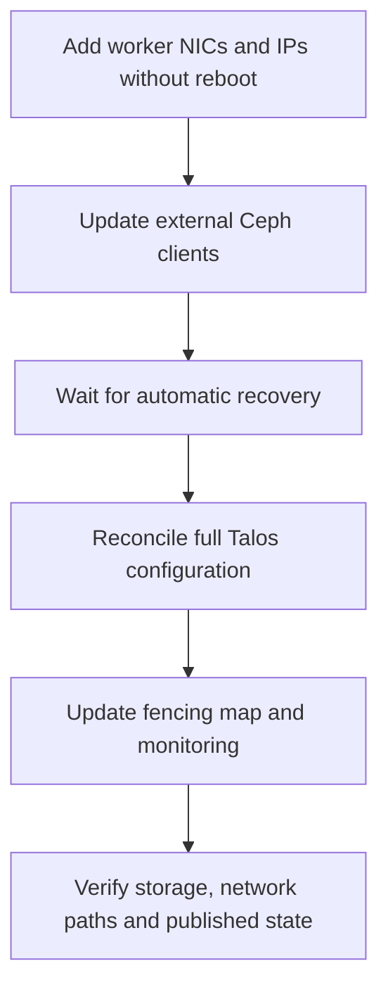

# Migrate worker connectivity to a dedicated external Ceph network

Use this workflow when adding worker secondary NICs/IPs or changing external
Ceph monitor endpoints. Keep site-specific PVE network cutover details in the
operator's private runbook; this workflow changes Kubernetes clients.

## Before deployment

Apply `AGENTS.md` authorization and state synchronization rules. Obtain the named
cluster and section scope. Require published, clean platform and cluster source,
review secondary addresses across cluster/infra inventories, and start the
existing control planes and workers. Keep infra VM deployments separate.

Load `.envrc` from the real cluster directory. Read live deployment provenance.
Capture original PVC UID/PV bindings and infrastructure health. Validate that
PVE's intended external Ceph public network and its own storage clients already
work. For running Tempo, use the maintenance checks in
[monitoring-version-migration.md](monitoring-version-migration.md).

## Sequence



### 1. Bootstrap secondary connectivity

```bash
../../scripts/deploy.sh --bootstrap-secondary-network
```

Completion: every selected worker has its secondary address, unchanged boot ID
and primary default routing; partial runtime state is published. This mode
deliberately leaves the full `k8s` deployment record unchanged.

The mode accepts additive NIC/IP changes only. It reviews a targeted OpenTofu
plan with provider reboots disabled, then dry-runs every Talos network-only patch
before applying any patch in explicit no-reboot mode. Hardware changes, VM
replacement, an altered primary NIC, conflicting addresses, address renumbering,
and existing staged Talos configuration stop the operation. Fix/review that
condition instead of replacing the operation with an unrestricted root apply.
Overlapping primary/secondary subnets are also rejected. Existing control-plane
capacity deficits do not block this strictly network-only plan; full Talos
reconciliation retains its normal capacity check.

### 2. Update Ceph before entering planned maintenance

```bash
../../scripts/deploy.sh --services-only --skip-k8s-net --skip-identity \
  --skip-s3-storage --skip-platform --skip-kafka --skip-monitoring --skip-benchmark
python3 ../../scripts/wait-for-node-recovery.py --kubeconfig out/kubeconfig
```

Completion: the actual CSI ConfigMap consumes the current monitor endpoints;
normal automatic recovery has finished, with Ready, uncordoned nodes and no
NetworkFences. The wait command reads nodes/fences only, not application Pods.

Ceph deployment waits for monitor propagation before restarting CSI. After an
external CSI configuration change, it refreshes CSI-Addons connections after
the CSI rollouts. Native leader leases may still need to expire; this bounded
wait is different from a stuck connection to a deleted pod. Inspect current
controller/driver errors on timeout. Preserve fencing and VolumeAttachments;
the controllers must complete their normal release/unfence protocol.
An interrupted Ceph run retains its pre-change configuration hash in the cluster
Git directory. Retry from the same PC: CSI and CSI-Addons refreshes are still
required even if the ConfigMaps already contain the desired endpoints. The
pending marker is removed only after the rollouts finish successfully.

### 3. Reconcile full Talos configuration

```bash
../../scripts/deploy.sh --talos-only --infrastructure-health-only
```

Use the infrastructure-only flag when the operator has excluded nominal
application failures from rollout acceptance. Default deployments continue to
guard application availability. Both modes retain drains, PDBs, storage fencing,
etcd checks and graceful node restarts.

Completion: full desired machine configurations are active, node maintenance is
released and runtime state is published. Compatible changes remain live; changes
requiring reboot still use sequential drained activation. In particular, kernel
proxy/environment changes can require every node to restart. Do not promise that
NIC hotplug removes those later reboots.

Omit service skip flags in Talos-only mode when those services still run: these
flags change generated `no_proxy`, despite Talos-only already skipping service
deployment. Changing them unnecessarily can cause another complete restart cycle.

### 4. Reconcile fencing and monitoring

```bash
../../scripts/deploy.sh --services-only --skip-ceph --skip-identity \
  --skip-s3-storage --skip-platform --skip-kafka --skip-benchmark
```

Completion: the remediation map includes both worker addresses, monitoring
passes and its state/provenance is published. Reuse recent Tempo block polling
only when configuration and ready container identities are unchanged; changed
containers/configuration still require a fresh poll. Block/index errors always
fail. Prometheus must reload the mounted configuration even on a retry after a
partial apply. Goldilocks' operational restart annotation is a computed field.

## Acceptance and batching

- Verify all selected nodes Ready/uncordoned and infrastructure workloads healthy.
  Preserve original PVC UID/PV bindings and clear bounded maintenance state.
- Check each worker's direct routes and ARP mappings to Ceph. Inspect established
  connections from the PVE side as well, including Pod traffic after SNAT; worker
  host-network sockets alone do not cover every client.
- Provision temporary CephFS/RBD claims; fsync writes and read them from another
  Pod. Remove the test namespace and confirm its PVs disappeared.
- Check new Ceph metric targets, collector targets, backend health, Tempo block
  reads, one new trace and one historical trace captured before maintenance.
- Confirm relevant deployment records match source; distinguish runtime-only
  commits from operational source drift. A successful network-only bootstrap
  alone is not full Talos consolidation.
- Update the existing cluster logbook entry with dates, durations and exceptions.
  Keep recovery data/snapshots only when an actual storage issue justifies them.

Validate this new flow on one approved cluster before batching the others.
Initially limit simultaneous rollouts to two clusters sharing a PVE/Ceph backend;
increase concurrency only with measured capacity and operator scope approval.
